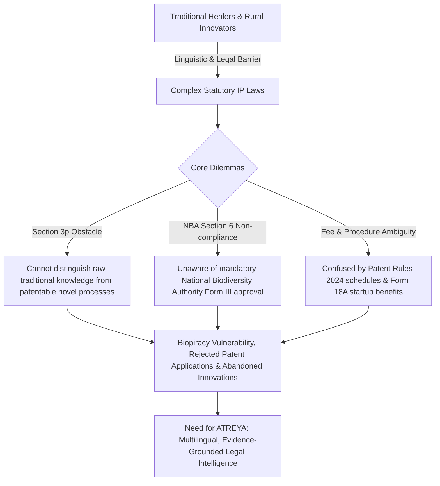
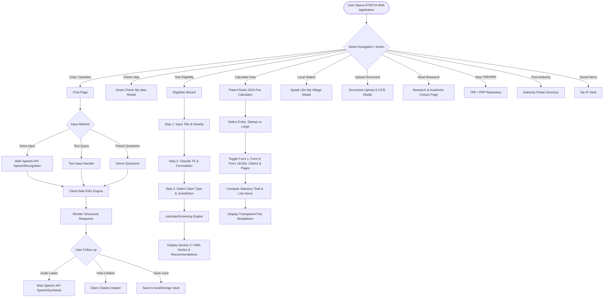
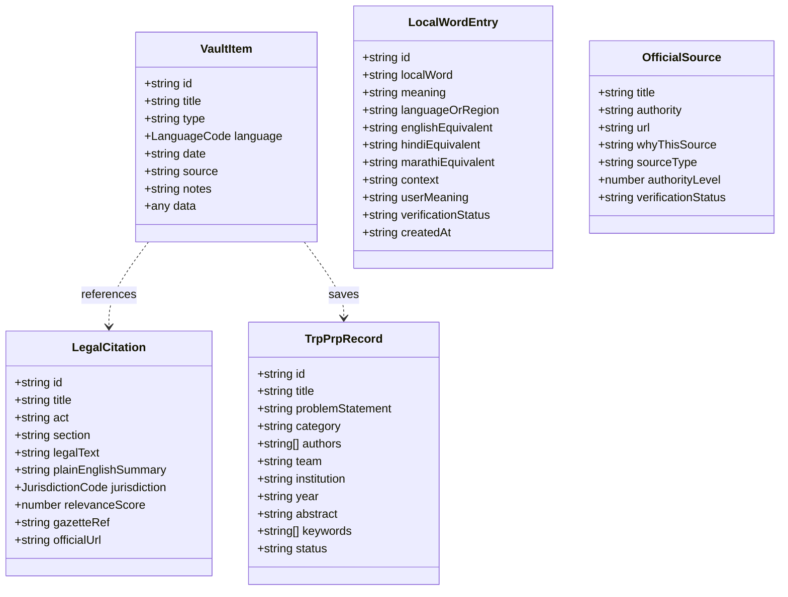
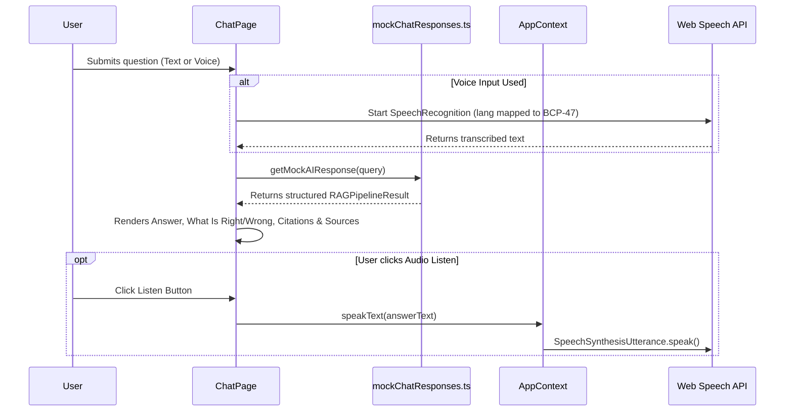
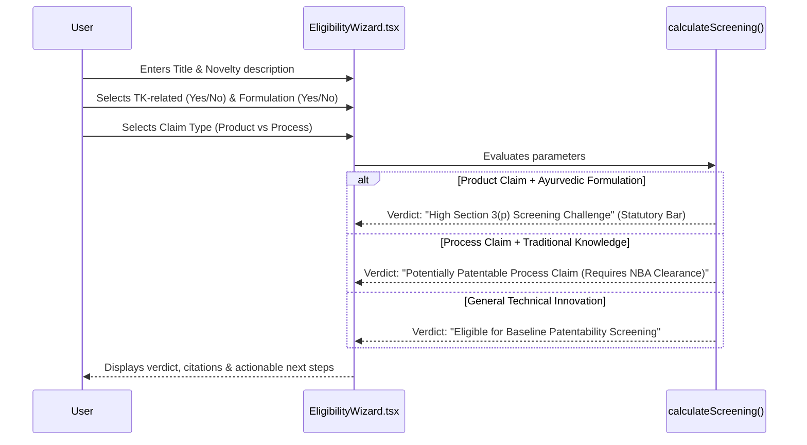
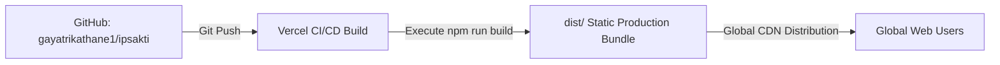

# ATREYA (IPSakti)

> **Multilingual AI Assistant Grounded in Indian Intellectual Property Laws, Ayurveda & Traditional Knowledge Safeguards**

[](https://github.com/gayatrikathane1/ipsakti)
[](https://github.com/gayatrikathane1/ipsakti)
[](https://react.dev)
[](https://www.typescriptlang.org)
[](https://vitejs.dev)
[](https://tailwindcss.com)
[](https://oxc.rs)
[](https://vercel.com)

**ATREYA** (also deployed as **IPSakti**) is a specialized, evidence-grounded legal intelligence web platform designed to address **Smart India Hackathon (SIH) 2026 Problem Statement 26045**. The platform empowers traditional Ayurvedic healers, grassroots inventors, DPIIT-recognized startups, and academic researchers to navigate Indian Intellectual Property Rights (IPR). It provides statutory guidance on patent exclusions under **Section 3(p)**, **Section 3(d)**, **Section 3(e)**, and **Section 3(k)** of the Indian Patents Act 1970, prior art defense mechanisms from the **CSIR-TKDL** (Traditional Knowledge Digital Library) repository, regulatory compliance under the **Biological Diversity Act 2002 (Section 6)**, statutory filing fee calculations under **Patent Rules 2024**, and interactive dialect translation across **30 languages** with speech synthesis and voice recognition.

---

## 📚 Table of Contents

- [📌 Project Overview](#-project-overview)
- [🎯 Problem Statement](#-problem-statement)
- [💡 Solution](#-solution)
- [✨ Features](#-features)
  - [👤 User Features](#-user-features)
  - [⚙️ Knowledge & System Features](#️-knowledge--system-features)
  - [🔐 Security & Privacy Features](#-security--privacy-features)
- [👥 User Roles](#-user-roles)
- [🔄 Complete Application Flow](#-complete-application-flow)
- [🏗️ System Architecture](#️-system-architecture)
- [🛠️ Technology Stack](#️-technology-stack)
- [📁 Project Structure](#-project-structure)
- [🎨 Frontend Architecture](#-frontend-architecture)
- [⚙️ Backend Architecture](#️-backend-architecture)
- [🗄️ Database Architecture](#️-database-architecture)
- [🔌 API Documentation](#-api-documentation)
- [🔐 Authentication & Authorization](#-authentication--authorization)
- [🔄 Important Technical Workflows](#-important-technical-workflows)
- [🔐 Environment Variables](#-environment-variables)
- [🚀 Installation & Setup](#-installation--setup)
- [▶️ Running the Application](#️-running-the-application)
- [📸 Screenshots](#-screenshots)
- [🧪 Testing](#-testing)
- [🔒 Security Considerations](#-security-considerations)
- [☁️ Deployment](#️-deployment)
- [⚠️ Known Limitations](#️-known-limitations)
- [🔮 Future Scope](#-future-scope)
- [📊 Technical Decisions](#-technical-decisions)
- [🧑‍💻 Contributing](#-contributing)
- [👨‍💻 Contributors](#-contributors)
- [📄 License](#-license)

---

## 📌 Project Overview

ATREYA serves as a bilingual and multilingual bridge between traditional community healers, grassroots inventors, and formal intellectual property offices. In India, classical Ayurvedic treatises (*Charaka Samhita*, *Sushruta Samhita*, *Ashtanga Hridaya*) and oral folklore remedies are protected from private patent monopolies by **Section 3(p)** of the Patents Act, 1970. However, researchers who develop genuine novel extraction methods, isolated active compounds, or synergistic drug delivery mechanisms often struggle to distinguish between non-patentable traditional knowledge and patent-eligible process claims.

### Core Capabilities
- **Statutory Legal Intelligence**: Answers questions grounded strictly in the *Patents Act 1970*, *Trade Marks Act 1999*, *Biological Diversity Act 2002*, and *Patent Rules 2024*.
- **Section 3 Screening**: Evaluates whether an invention is an unpatentable traditional aggregation (Section 3(p)), a mere discovery of a known property (Section 3(d)), an admixture without synergy (Section 3(e)), or a software algorithm lacking hardware technical effect (Section 3(k)).
- **CSIR-TKDL Prior Art Defense**: Explains how the Traditional Knowledge Digital Library prevents international biopiracy by supplying prior art evidence to examiners at the USPTO, EPO, JPO, and IPO.
- **Statutory Fee Calculator**: Dynamically calculates official government filing fees for Individuals/Startups vs. Large Entities under the latest *Patent Rules 2024* (G.S.R. 204(E) effective March 15, 2024), covering Form 1, Form 9, Form 18, Form 18A (Expedited Track), extra claims, extra pages, and Trademark Form TM-A.
- **Multilingual & Voice-First Access**: Supports 30 languages (22 Scheduled Indian languages, village dialect bridges, and 5 international languages) with native Web Speech API voice input, text-to-speech output, and full RTL layout support for Urdu and Arabic.
- **"Speak Like My Village" Dialect Bridge**: Enables grassroots users to submit local dialect terms and folk herbal vocabulary (e.g., Varhadi, Bhojpuri, Maithili, Gondi) and maps them to botanical, English, Hindi, and Marathi equivalents with verification flags.

---

## 🎯 Problem Statement

### Background
India possesses one of the richest traditional medicinal heritages in the world, spanning Ayurveda, Siddha, Unani, Sowa-Rigpa, and localized tribal medicine. Historically, foreign corporations have attempted to claim patent monopolies on centuries-old Indian remedies, such as the infamous US patent grants on the wound-healing properties of Turmeric (*Curcuma longa*) and the fungicidal properties of Neem (*Azadirachta indica*). While India successfully revoked those patents through CSIR's documented prior art, domestic grassroots innovators continue to face serious systemic barriers.



### Challenges Addressed
1. **Linguistic Exclusion**: Official patent documents, gazette notifications, and legal manuals are written in complex English and statutory Hindi, excluding rural innovators who speak local dialects.
2. **Statutory Ambiguity**: Confusion surrounding whether an Ayurvedic formulation can be patented, or whether protection should instead take the form of a Trademark (Form TM-A Class 5), a Process Patent, or a Geographical Indication (GI).
3. **Biodiversity Penalties**: Innovators commercializing Indian biological resources frequently violate Section 6 of the *Biological Diversity Act 2002* due to ignorance of mandatory National Biodiversity Authority (NBA) clearances.
4. **Filing Costs & Complex Forms**: Small enterprises are unaware of the 80% fee reductions and Form 18A expedited examination tracks granted to DPIIT-recognized startups under *Patent Rules 2024*.

---

## 💡 Solution

ATREYA implements a zero-barrier, browser-based legal intelligence system that translates statutory laws into clear, actionable advice:

1. **Client-Side Retrieval Pipeline**: Automatically maps user inquiries to verified legal citations from the *Patents Act 1970*, *Trade Marks Act 1999*, and *Biological Diversity Act 2002*, accompanied by relevance confidence scores.
2. **Evidence-Grounded Explanations**: Generates structured responses containing what is legally permissible ("What is Right"), statutory prohibitions ("What is Wrong"), concrete steps, and direct citations to primary statutory portals.
3. **Interactive Decision Wizards**: Allows users to step through guided questions regarding formulation type, claim category (Product vs. Process), and biological materials to receive immediate Section 3(p) and NBA clearance risk assessments.
4. **Transparent Source Hierarchy**: Every legal reference is classified into a 7-tier authority hierarchy (ranging from Level 1 Primary Legislation down to Level 7 Secondary References), accompanied by direct links to official government portals (`ipindia.gov.in`, `tkdl.res.in`, `nbaindia.org`, `ayush.gov.in`).
5. **Zero-API, 100% Client-Side Privacy**: Runs completely inside the user's web browser without sending confidential invention details, formulation notes, or trade secrets across external third-party AI APIs.

---

## ✨ Features

### 👤 User Features

- **Multilingual Legal Chat Assistant**: Interactive AI assistant grounded in statutory Indian IP provisions with suggested follow-up prompts, legal disclaimers, and categorized statutory cards.
- **Voice Controller (Speech-to-Text & Text-to-Speech)**:
  - Speech recognition input powered by the native `SpeechRecognition` API.
  - Text-to-speech audio playback powered by `SpeechSynthesisUtterance` mapped to BCP-47 locale tags (e.g., `hi-IN`, `mr-IN`, `bn-IN`, `en-IN`, `ta-IN`).
- **30-Language Support**:
  - **Scheduled Indian Languages**: English, Hindi (हिन्दी), Marathi (मराठी), Bengali (বাংলা), Tamil (தமிழ்), Telugu (తెలుగు), Gujarati (ગુજરાતી), Kannada (ಕನ್ನಡ), Malayalam (മലയാളം), Punjabi (ਪੰਜਾਬੀ), Odia (ଓଡ଼ିଆ), Assamese (অসমীয়া), Urdu (اردو), Sanskrit (संस्कृतम्), Maithili (मैथिली), Santali (ᱥᱟᱱᱛᱟᱲᱤ), Kashmiri (कॉशुर), Nepali (नेपाली), Konkani (कोंकणी), Dogri (डोगरी), Bodo (बड़ो), Manipuri (মৈতৈলোন্).
  - **Regional & Village Dialects**: Sindhi (سنڌي), Khasi (Ka Ktien Khasi), Mizo (Mizo ṭawng), Varhadi, Bhojpuri, Ahirani, Chhattisgarhi, Nimadi, Malvi, Marwari, Bundeli.
  - **International Languages**: French (Français), Spanish (Español), Arabic (العربية), Japanese (日本語), Mandarin Chinese (中文).
  - **RTL Support**: Automatic `dir="rtl"` layout switching for Urdu and Arabic.
- **Smart "Check My Idea" Analyzer**:
  - Modal utility allowing creators to input an invention or herbal concept.
  - Generates an 8-point summary: Traditional Knowledge relevance, suggested IP categories, clinical research areas, competent statutory authorities, critical verification questions, and immediate next steps.
- **Section 3 Eligibility Wizard**:
  - Step-by-step screening tool analyzing invention title, novelty claims, TK affiliation, and product vs. process classifications.
  - Predicts statutory hurdles under Section 3(p), Section 3(e), and Section 3(d), while evaluating whether National Biodiversity Authority (NBA) Form III approval is mandatory.
- **Statutory Fee Calculator (Patent Rules 2024)**:
  - Real-time fee computation for Indian patent and trademark filings.
  - Incorporates the latest official schedule (G.S.R. 204(E)):
    - Form 1 (Application Filing): ₹1,600 (Startup/Individual) vs. ₹8,000 (Large Entity).
    - Form 9 (Early Publication): ₹2,500 vs. ₹12,500.
    - Form 18 (Normal Examination - RFE): ₹4,000 vs. ₹20,000.
    - Form 18A (Expedited Examination Track): ₹8,000 vs. ₹60,000.
    - Excess Claims beyond 10: ₹320 vs. ₹1,600 per claim.
    - Excess Pages beyond 30: ₹160 vs. ₹800 per page.
    - Trademark Form TM-A: ₹4,500 vs. ₹9,000 per class.
- **Document Upload & Simulated OCR**:
  - Allows uploading technical documents or patent specification drafts.
  - Analyzes document keywords to extract technical topics (e.g., polyherbal extraction vs. AI microcontroller synergy) and maps them directly to relevant legal citations (Section 3(p) vs. Section 3(k)).
- **"Speak Like My Village" Local Word Bridge**:
  - Community-driven dialect vocabulary repository.
  - Allows users to document local village names for herbs, preparation techniques, and traditional uses.
  - Displays verification statuses: `User-provided local meaning`, `Requires Verification`, or `Verified`.
- **My IP Vault**:
  - Client-side persistent research repository.
  - Save chat answers, statutory evidence cards, TRP/PRP research papers, and idea screenings directly to browser storage.
  - Includes full text search and category filtering.
- **Statutory Citation Inspector**:
  - Slide-out drawer presenting complete statutory provisions, act titles, sections/rules, plain-language summaries, gazette references, official URLs, and AI statutory relevance confidence scores.

### ⚙️ Knowledge & System Features

- **7-Tier Authority Hierarchy**: All legal references strictly categorized into:
  - *Level 1*: Primary Legal Source (Acts of Parliament)
  - *Level 2*: Statutory / Government Authority (IP India, NBA, Ayush)
  - *Level 3*: Official Government Research (CSIR-TKDL, ICMR, CCRAS)
  - *Level 4*: International Official Treaties (WIPO, PCT, WTO TRIPS)
  - *Level 5*: Peer-Reviewed Research Journals (AYUSH Research Portal)
  - *Level 6*: Reference Books & Classical Treatises (*Charaka Samhita*, *Ayurvedic Pharmacopoeia of India*)
  - *Level 7*: Secondary Sources & Industry Manuals
- **Technical Research Papers (TRP & PRP) Repository**:
  - Dedicated viewer and print/download module for SIH 2026 technical research papers.
  - Filterable by paper category (`TRP` vs. `PRP`), publication year, and language.
- **Official Authority Finder**:
  - Directory of central regulatory bodies (CGPDTM, TKDL, NBA, Ministry of Ayush, FSSAI, WIPO, USPTO, EPO).
  - Outlines exact services provided, domain expertise, and direct official URLs.
- **Problem Solver Scenario Matrix**:
  - 12 pre-configured practical user scenarios covering traditional knowledge, novel Ayurveda ideas, research paper evaluation, herbal formulations, brand trademarks, startup expedited filings, geographical indications, and international PCT patents.
- **"Simple Mode" Toggle**:
  - Plain-English / non-technical explanation switch stored in `localStorage`, simplifying complex legal terms into plain language for laypersons.

### 🔐 Security & Privacy Features

- **100% Client-Side Privacy**: Zero transmission of user prompts, research data, or draft patent specifications to external cloud servers.
- **Zero API Keys Required**: Does not rely on paid, metered, or leaky third-party cloud APIs.
- **Local Persistence**: User vault items and dialect word submissions are stored strictly in the client's browser `localStorage`.

---

## 👥 User Roles

| Role | Target Users | Capabilities Implemented in ATREYA |
| :--- | :--- | :--- |
| **Traditional Knowledge Holder / Rural Practitioner** | Vaidyas, tribal healers, herbal remedy creators, village artisans | Uses voice input in local language; searches classical remedies; checks Section 3(p) restrictions; submits dialect words in "Speak Like My Village"; checks anti-biopiracy safeguards. |
| **Startup Founder / Grassroots Innovator** | DPIIT-registered startups, MSMEs, solo inventors | Calculates filing fees with startup subsidies; explores Form 18A expedited examination; tests process patent eligibility; checks trademark class 5 rules. |
| **Research Scholar / Patent Attorney** | Students, pharmacognosy researchers, IP agents | Inspects statutory citations; reviews TRP/PRP academic papers; cross-references CSIR-TKDL and AYUSH research portal entries; verifies NBA Form III compliance. |
| **SIH Evaluator / Hackathon Judge** | College professors, technical evaluators, jury members | Inspects system architecture, technical research documentation (TRP/PRP), 30-language localization engine, and statutory accuracy under SIH Problem Statement 26045. |

---

## 🔄 Complete Application Flow



---

## 🏗️ System Architecture

```mermaid
graph TB
    subgraph Client_Browser ["User Web Browser (Client-Side Only)"]
        subgraph UI_Layer ["Presentation Layer (React 19 + Tailwind CSS v4)"]
            Navbar[Navbar Component & Language Selector]
            HomePage[Home Page & Hero Section]
            ChatPage[Conversational Chat Page]
            TraditionalKnowledgePage[TK & TKDL Resource Hub]
            ResearchPage[Research Corpus & Books Page]
            TrpPage[TRP & PRP Technical Documents Page]
            Modals[Modals: Fee Calc, Eligibility, Check Idea, Local Word, Doc Upload]
            Drawers[Drawers: Citation Inspector & My IP Vault]
            Footer[Footer & Statutory Disclaimers]
        end

        subgraph State_Layer ["Application State Layer (React Context)"]
            AppContext[AppContext.tsx Provider]
            LanguageState[Language & RTL Controller]
            JurisdictionState[Jurisdiction Filter IPO vs WIPO]
            VaultState[Vault CRUD Manager]
            LocalWordState[Local Word Registry Manager]
            SpeechState[Voice Recognition & TTS Controller]
        end

        subgraph Core_Logic ["Core Processing & Reasoning Engines"]
            RAGEngine[Mock RAG Engine & Intent Classifier]
            FeeEngine[Patent Rules 2024 Fee Computation Engine]
            ScreeningEngine[Section 3 & NBA Screening Engine]
            OCREngine[Simulated Document Text & Topic Extractor]
            DialectBridge[Village Dialect to Botanical/IP Resolver]
            TranslationResolver[Hierarchical Locale Fallback Resolver]
        end

        subgraph Data_Corpus ["Embedded Static Legal & Academic Corpus"]
            MockKnowledge[mockKnowledgeBase.ts: Citations & Books]
            OfficialSources[officialSources.ts: 7-Tier Statutory Database]
            OfficialAuthorities[officialAuthorities.ts: Regulatory Bodies]
            TrustedCorpus[trustedCorpus.ts: Section 3p, TKDL, NBA Text Chunks]
            TrpPrpRepo[trpPrpRepository.ts: SIH 26045 Research Papers]
            Locales[30 Locale JSON Files: en, hi, mr, bn, ta, te, gu, etc.]
        end

        subgraph Browser_APIs ["Native Web Browser APIs"]
            WebSpeechAPI[SpeechRecognition API - Voice Input]
            SpeechSynthesisAPI[SpeechSynthesis API - Audio Output]
            LocalStorage[Window.localStorage - Persistent Storage]
            ClipboardAPI[Navigator.clipboard - Copying Citations]
            WindowPrint[Window.print - TRP/PRP Export]
        end
    end

    %% Wiring
    UI_Layer --> AppContext
    AppContext --> Core_Logic
    Core_Logic --> Data_Corpus
    AppContext --> Browser_APIs
```



---

## 🛠️ Technology Stack

| Layer | Technology | Version | Purpose |
| :--- | :--- | :--- | :--- |
| **Frontend Framework** | React | `^19.2.8` | Component-based UI library powering modern reactive user interfaces. |
| **DOM Renderer** | React DOM | `^19.2.8` | DOM rendering integration for React 19. |
| **Language & Typings** | TypeScript | `~6.0.2` | Static type checking and strict interface definitions across all components and data structures. |
| **Build Tool & Bundler** | Vite | `^8.3.0` | Ultra-fast build tool, local development server with Hot Module Replacement (HMR). |
| **Vite React Plugin** | `@vitejs/plugin-react` | `^6.1.1` | Official Vite plugin providing React Fast Refresh and JSX transformation. |
| **Styling Framework** | Tailwind CSS | `^4.3.3` | Next-generation utility-first styling engine. |
| **Vite Tailwind Plugin** | `@tailwindcss/vite` | `^4.3.3` | Official Vite bundler plugin for seamless Tailwind CSS v4 compilation. |
| **Iconography** | Lucide React | `^1.47.0` | Clean, accessible SVG iconography for legal, botanical, and navigation elements. |
| **Linter & Code Quality** | Oxlint | `^1.81.0` | High-performance Rust-based JavaScript and TypeScript linter. |
| **Type Definitions** | `@types/node`, `@types/react`, `@types/react-dom` | Latest | Complete TypeScript declaration files. |
| **Client Storage** | Browser `localStorage` | Native Web API | Persistent storage for user vault items, local word submissions, and user preferences. |
| **Speech Services** | Web Speech API | Native Web API | Speech-to-text transcription and multilingual audio playback. |
| **Deployment Target** | Vercel | Configuration | Configured via `vercel.json` for single-page application rewrites and static hosting. |

---

## 📁 Project Structure

```
ATREYA/
├── .gitignore               # Git exclusion list (node_modules, dist, .vercel, logs)
├── .oxlintrc.json           # Oxlint configuration schema, plugins & rules
├── index.html               # Main HTML entry point with meta tags & root div
├── package.json             # NPM dependencies, scripts, and project metadata
├── package-lock.json        # Deterministic dependency lockfile
├── README.md                # Comprehensive project documentation
├── tsconfig.json            # Root TypeScript project references configuration
├── tsconfig.app.json        # TypeScript compiler options for frontend source code
├── tsconfig.node.json       # TypeScript compiler options for Vite configuration
├── vercel.json              # Vercel deployment configuration with SPA URL rewrites
├── vite.config.ts           # Vite build and plugin configuration
├── public/
│   ├── favicon.svg          # Application browser favicon
│   └── icons.svg            # SVG vector icon assets
└── src/
    ├── App.css              # Custom layout animations and print styles
    ├── App.tsx              # Root application layout, modals, and conditional page router
    ├── index.css            # Tailwind CSS v4 imports and theme definitions
    ├── main.tsx             # React application entry point with StrictMode
    ├── assets/
    │   ├── hero.png         # Project hero banner asset
    │   ├── react.svg        # React SVG logo
    │   └── vite.svg         # Vite SVG logo
    ├── components/
    │   ├── AuthorityFinderSection.tsx    # Directory of official statutory authorities
    │   ├── CheckMyIdeaModal.tsx          # 8-point smart invention evaluation modal
    │   ├── CitationDrawer.tsx            # Slide-out statutory provision inspector
    │   ├── DisclaimerModal.tsx           # Official legal disclaimer & limitation modal
    │   ├── DocumentUploadModal.tsx       # Specification upload & simulated OCR extraction
    │   ├── EligibilityWizard.tsx         # Multi-step Section 3 & NBA clearance screener
    │   ├── ExplainSimplyModal.tsx        # Plain-English translation modal
    │   ├── FeeCalculatorModal.tsx        # Patent Rules 2024 statutory fee computation
    │   ├── Footer.tsx                    # Application footer with statutory links
    │   ├── LegalInformationCenter.tsx    # Comprehensive legal acts & sections directory
    │   ├── LocalWordModal.tsx            # "Speak Like My Village" dialect word manager
    │   ├── Navbar.tsx                    # Header with 30-language selector & search
    │   ├── OfficialLegalSourcesSection.tsx # 7-tier legal authority source repository
    │   ├── OfficialResourceDirectory.tsx # External government links directory
    │   ├── ProblemSolverSection.tsx      # 12-scenario practical problem matrix
    │   ├── VaultDrawer.tsx               # My IP Vault client storage interface
    │   ├── VoiceController.tsx           # Web Speech API voice input/output controller
    │   └── WhyThisSourceModal.tsx        # Authority hierarchy justification modal
    ├── context/
    │   └── AppContext.tsx   # Global React Context, state management & translation engine
    ├── data/
    │   ├── mockChatResponses.ts          # Pre-built RAG responses & question matching logic
    │   ├── mockKnowledgeBase.ts          # Statutory citations, books & research resources
    │   ├── officialAuthorities.ts        # Database of statutory bodies & portals
    │   ├── officialSources.ts            # 7-tier categorized legal sources database
    │   ├── translations.ts               # Language metadata & legacy translation strings
    │   ├── trdCorpus.ts                  # SIH 26045 problem statement corpus references
    │   ├── trpPrpRepository.ts           # Technical and Project Research Paper records
    │   └── trustedCorpus.ts              # Primary statutory act excerpts and provisions
    ├── locales/             # 30 Comprehensive Locale JSON translation files
    │   ├── ar.json          # Arabic (العربية)
    │   ├── as.json          # Assamese (অসমীয়া)
    │   ├── bn.json          # Bengali (বাংলা)
    │   ├── brx.json         # Bodo (बड़ो)
    │   ├── doi.json         # Dogri (डोगरी)
    │   ├── en.json          # English
    │   ├── es.json          # Spanish (Español)
    │   ├── fr.json          # French (Français)
    │   ├── gu.json          # Gujarati (ગુજરાતી)
    │   ├── hi.json          # Hindi (हिन्दी)
    │   ├── ja.json          # Japanese (日本語)
    │   ├── kha.json         # Khasi (Ka Ktien Khasi)
    │   ├── kn.json          # Kannada (ಕನ್ನಡ)
    │   ├── kok.json         # Konkani (कोंकणी)
    │   ├── ks.json          # Kashmiri (कॉशुर)
    │   ├── lus.json         # Mizo (Mizo ṭawng)
    │   ├── mai.json         # Maithili (मैथिली)
    │   ├── ml.json          # Malayalam (മലയാളം)
    │   ├── mni.json         # Manipuri (মৈতৈলোন্)
    │   ├── mr.json          # Marathi (मराठी)
    │   ├── ne.json          # Nepali (नेपाली)
    │   ├── or.json          # Odia (ଓଡ଼ିଆ)
    │   ├── pa.json          # Punjabi (ਪੰਜਾਬੀ)
    │   ├── sa.json          # Sanskrit (संस्कृतम्)
    │   ├── sat.json         # Santali (ᱥᱟᱱᱛᱟᱲᱤ)
    │   ├── sd.json          # Sindhi (سنڌي)
    │   ├── ta.json          # Tamil (தமிழ்)
    │   ├── te.json          # Telugu (తెలుగు)
    │   ├── ur.json          # Urdu (اردو)
    │   └── zh.json          # Mandarin Chinese (中文)
    ├── pages/
    │   ├── ChatPage.tsx                  # Multilingual conversational AI chat interface
    │   ├── HomePage.tsx                  # Landing view, hero, quick actions & local bridge
    │   ├── KnowledgePage.tsx             # Direct redirect to vault and knowledge records
    │   ├── PrpPage.tsx                   # Project Research Paper (PRP) document viewer
    │   ├── ResearchPage.tsx              # Academic research papers & classical treatises
    │   ├── TraditionalKnowledgePage.tsx  # TKDL & Section 3(p) educational hub
    │   ├── TrpPage.tsx                   # Technical Research Paper (TRP) document viewer
    │   └── TrpPrpPage.tsx                # Combined TRP/PRP search and filter explorer
    └── types/
        └── ip.ts            # Strict TypeScript interfaces, models, and union types
```

---

## 🎨 Frontend Architecture

The user interface is built on React 19 utilizing functional components, custom hooks, and Tailwind CSS v4:

### 1. State Management (`AppContext.tsx`)
Global application state is managed via React Context API (`AppContext` / `AppProvider`), avoiding bulky external dependencies like Redux. The context exposes:
- Active page view (`activePage`, `setActivePage`)
- Active language (`language`, `setLanguage`) with localStorage synchronization (`atreya_lang`)
- Active jurisdiction filter (`jurisdiction`, `setJurisdiction`, `jurisdictionFilter`)
- Active legal citation selected for detailed inspection (`activeCitation`, `setActiveCitation`)
- Global modal visibility flags for all 7 utility modals
- "Simple Mode" toggle state with localStorage synchronization (`atreya_simple_mode`)
- Saved vault items array with localStorage synchronization (`atreya_vault`)
- Saved local dialect word entries with localStorage synchronization (`atreya_local_words`)
- Active text-to-speech audio state (`speakText`, `isSpeaking`, `stopSpeaking`)
- Translation lookup helper (`t(keyPath, fallback)`)

### 2. Custom Page Routing
Rather than requiring complex client-side routing libraries, navigation is cleanly coordinated via a lightweight `PageView` type:
```typescript
export type PageView =
  | 'home'
  | 'chat'
  | 'knowledge'
  | 'tk'
  | 'research'
  | 'trp'
  | 'prp'
  | 'authorities'
  | 'directory'
  | 'solver'
  | 'idea'
  | 'localword';
```
In `src/App.tsx`, `<MainContent>` renders the corresponding page component conditionally, ensuring instant transitions without page reloads.

### 3. Hierarchical Localization Engine
The translation helper function `t(keyPath: string, fallback?: string): string` executes a 4-stage resolution pipeline:
1. Looks up the nested key inside the currently active language's JSON file (`src/locales/{language}.json`).
2. If unresolved and the language is a village dialect, queries the dialect's configured fallback language (e.g., Varhadi -> Marathi).
3. If still unresolved, queries the master English locale (`src/locales/en.json`).
4. If still unresolved, falls back to legacy `UI_STRINGS` or the provided fallback string.
5. In addition, when Urdu (`ur`) or Arabic (`ar`) is active, an effect automatically sets `document.documentElement.setAttribute('dir', 'rtl')`.

---

## ⚙️ Backend Architecture

### Client-Side Execution Reality
**ATREYA is intentionally engineered as a 100% client-side single-page application (SPA).**
There is **no standalone backend server** (e.g., Express, Django, FastAPI, NestJS) running in this repository.

```
Client Browser
     │
     ├── 1. User submits query / action
     │
     ├── 2. React Component triggers internal logic
     │
     ├── 3. Client-side Service / Engine processes input:
     │      ├── mockChatResponses.ts  (Simulated RAG Pipeline)
     │      ├── trpPrpRepository.ts   (Research Paper Filter)
     │      ├── EligibilityWizard.tsx (Deterministic Section 3 Screener)
     │      └── FeeCalculatorModal.tsx (Patent Rules 2024 Math Engine)
     │
     ├── 4. LocalStorage read/write for persistent entities
     │
     └── 5. Immediate UI Update in Browser DOM
```

### Why a Client-Side Design?
- **Zero Cost & High Accessibility**: Rural clinics, universities, and small inventors can access the platform without subscription paywalls, server outages, or API quotas.
- **Strict Invention Privacy**: Ideas, chemical formulations, and draft claims are never sent to external servers before a provisional patent is officially filed on `ipindia.gov.in`.
- **Offline / Edge Feasibility**: The static bundle can be cached, packaged as a PWA, or deployed on lightweight edge servers.

---

## 🗄️ Database Architecture

The application does not connect to an external SQL or NoSQL database server. Instead, data persistence and structured records are handled through:

1. **Browser LocalStorage**: Persistent client-side key-value stores for user-generated data.
2. **In-Memory Static TypeScript Data Modules**: High-fidelity structured datasets compiled directly into the client bundle.

### Browser LocalStorage Collections

| Key Name | Type | Purpose |
| :--- | :--- | :--- |
| `atreya_vault` | `VaultItem[]` | Stores user-bookmarked citations, chat Q&As, research records, and custom ideas. |
| `atreya_local_words` | `LocalWordEntry[]` | Stores community dialect terms, regional names, and user-provided herbal meanings. |
| `atreya_lang` | `LanguageCode` | Stores the user's preferred language code across sessions. |
| `atreya_simple_mode` | `string` (`'true'` / `'false'`) | Stores the user's plain-English explanation toggle state. |

### Data Models & Interfaces



---

## 🔌 API Documentation

Because ATREYA is built with a client-side architecture, it exposes internal TypeScript service methods rather than network-accessible HTTP REST endpoints. Below are the primary internal service interfaces:

### 1. AI RAG Response Pipeline
- **Function**: `getMockAIResponse(userQuery: string): RAGPipelineResult`
- **Location**: `src/data/mockChatResponses.ts`
- **Description**: Evaluates the user's query against keyword patterns and semantic topics, retrieving statutory provisions, simple explanations, practical examples, and relevant government sources.
- **Parameters**: `userQuery` (*string*)
- **Return Structure**:
```typescript
interface RAGPipelineResult {
  ragAnswer: {
    answer: string;
    simpleExplanation?: string;
    realLifeExample?: string;
    relevantLaw?: string;
    whatIsRight?: string[];
    whatIsWrong?: string[];
    steps?: string[];
    whyPoints?: string[];
    evidence?: string;
    sources?: OfficialSource[];
    evidenceLevel?: 'high' | 'moderate' | 'insufficient';
  };
  citations: LegalCitation[];
  officialSources: OfficialSource[];
  suggestedFollowups: string[];
}
```

### 2. TRP / PRP Repository Search
- **Function**: `searchTrpPrpRepository(query, categoryFilter, yearFilter, languageFilter): TrpPrpRecord[]`
- **Location**: `src/data/trpPrpRepository.ts`
- **Description**: Filters the embedded technical and project research documents by keyword, document category (`TRP` vs. `PRP`), publication year, and language.

### 3. Patentability Screening Engine
- **Function**: `calculateScreening(): ScreeningResult`
- **Location**: `src/components/EligibilityWizard.tsx`
- **Description**: Evaluates user inputs on formulation type, traditional knowledge roots, and product vs. process claims to return statutory verdicts under Section 3(p) and NBA Section 6.

---

## 🔐 Authentication & Authorization

- **Authentication Model**: None implemented.
- **Access Level**: Public Open-Access.
- **Rationale**: ATREYA is structured as a public legal literacy and statutory research tool. All features (chat assistant, fee calculator, eligibility wizard, research library, and local word dictionary) are immediately accessible to anyone without account creation or login barriers.
- **User Data Isolation**: Any saved vault items or custom words reside solely in the user's local browser instance (`localStorage`).

---

## 🔄 Important Technical Workflows

### 1. RAG Query Processing & Evidence Grounding


### 2. Section 3(p) Patentability Screening Workflow


---

## 🔐 Environment Variables

ATREYA runs completely client-side and requires **no external API keys or environment variables**.

| Variable | Description | Required | Default Value |
| :--- | :--- | :--- | :--- |
| *None* | No `.env` variables required. | No | N/A |

---

## 🚀 Installation & Setup

### Prerequisites
- **Node.js**: `v18.0.0` or higher (Node.js 20+ recommended)
- **npm**: `v9.0.0` or higher
- **Git**: Installed and configured on your system

### 1. Clone the Repository
```bash
git clone https://github.com/gayatrikathane1/ipsakti.git
cd ipsakti
```

### 2. Install Dependencies
```bash
npm install
```

### 3. Start Development Server
```bash
npm run dev
```
The application will launch locally at `http://localhost:5173`.

---

## ▶️ Running the Application

All executable scripts are verified from `package.json`:

```bash
# Start local development server with Vite HMR
npm run dev

# Run TypeScript compilation and build production bundle
npm run build

# Run Oxlint high-speed linter
npm run lint

# Preview the built production dist directory locally
npm run preview
```

---

## 📸 Screenshots

> Screenshots will be added here.

---

## 🧪 Testing

Automated test suite is not currently included in the repository.

Static code analysis and linting are provided by **Oxlint**:
```bash
npm run lint
```
Type integrity is enforced via TypeScript project references:
```bash
npx tsc --noEmit
```

---

## 🔒 Security Considerations

- **Client-Side Data Privacy**: All user inputs, idea descriptions, formulation notes, and uploaded document snippets remain strictly inside the user's browser runtime. No data is sent to external AI servers.
- **XSS Prevention**: React automatically escapes strings before rendering them into the DOM, mitigating cross-site scripting vulnerabilities.
- **Zero Secret Exposure**: No API keys, credentials, or private access tokens are bundled or exposed in client assets.
- **RTL & Unicode Safety**: Text rendering accommodates complex Indian scripts (Devanagari, Tamil, Bengali, Gurmukhi, etc.) and RTL text (Urdu, Arabic) using standard UTF-8 encoding.

---

## ☁️ Deployment

ATREYA is configured for one-click static hosting on **Vercel** via [`vercel.json`](file:///C:/Users/rosha/Documents/ATREYA/vercel.json):

```json
{
  "framework": "vite",
  "buildCommand": "npm run build",
  "outputDirectory": "dist",
  "rewrites": [
    {
      "source": "/(.*)",
      "destination": "/index.html"
    }
  ]
}
```



---

## ⚠️ Known Limitations

- **Simulated RAG Pipeline**: AI conversational answers are generated through curated client-side knowledge modules rather than a live remote LLM endpoint.
- **Simulated OCR Extraction**: Document processing simulates text extraction based on filename and sample text rather than using heavy server-side optical character recognition.
- **Browser-Bound Persistence**: Vault items and dialect vocabulary are stored in browser `localStorage`, meaning data does not synchronize across different devices or browsers.
- **No Automated Test Coverage**: Unit and end-to-end test suites (e.g., Vitest, Playwright) are not currently configured.

---

## 🔮 Future Scope

| Current Implementation | Future Enhancement |
| :--- | :--- |
| Client-side mock RAG module | Live integration with a fine-tuned legal LLM (e.g., Gemini API / LangChain) with streaming responses. |
| Browser `localStorage` storage | Cloud-synced user accounts with multi-tenant PostgreSQL / Supabase backend. |
| Simulated OCR | Client-side Tesseract.js or serverless Cloud Vision OCR for live document digitization. |
| Static authority directory | Live API integration with IP India portal for real-time patent application status tracking. |
| Curated prior art references | Direct search indexing against WIPO PATENTSCOPE and the published TKDL database. |

---

## 📊 Technical Decisions

- **Why React 19?** React 19 provides modern component architecture, optimal hydration performance, and seamless reactive state updates across modals, drawers, and tabs.
- **Why Tailwind CSS v4?** The latest Tailwind CSS v4 delivers zero-config CSS compilation, modern CSS variables, and rapid UI development without heavy stylesheet overhead.
- **Why Client-Side RAG?** Traditional healers and rural inventors require immediate, cost-free, and private assistance without fear that their confidential recipes or novel processes will be logged by third-party cloud servers.
- **Why Oxlint?** Oxlint runs up to 50x faster than legacy ESLint, catching React hook misuse and code smells in milliseconds during development.

---

## 🧑‍💻 Contributing

Contributions are welcome! Please follow these steps:

1. Fork the repository.
2. Create a feature branch:
   ```bash
   git checkout -b feature/your-feature-name
   ```
3. Commit your changes:
   ```bash
   git commit -m "Add your feature description"
   ```
4. Verify build and linting:
   ```bash
   npm run lint
   npm run build
   ```
5. Push your branch:
   ```bash
   git push origin feature/your-feature-name
   ```
6. Open a Pull Request on GitHub.

---

## 👨‍💻 Contributors

This project was developed for **Smart India Hackathon 2026 (Problem Statement 26045)** by:

- **Gayatri Kathane** ([@gayatrikathane1](https://github.com/gayatrikathane1))
- *ATREYA Research & Legal Engineering Division*

---

## 📄 License

No license file is currently included in the repository. All rights reserved by the project authors.
